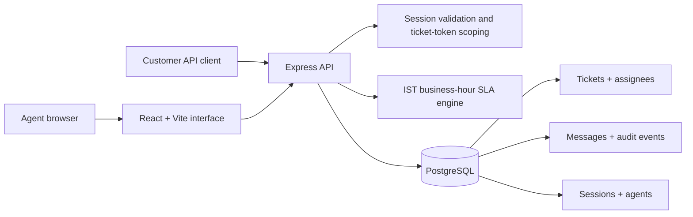
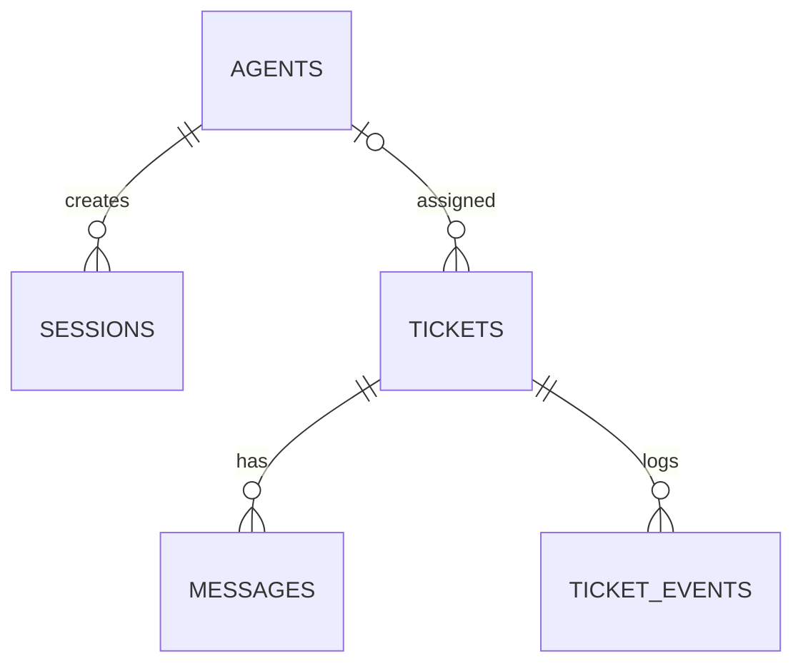

# System Design — ResolveHub

## Overview

ResolveHub is a single-deploy web application for support teams. A React single-page app communicates with an Express API, and PostgreSQL is the source of truth. It is an original implementation of a common helpdesk ticket management problem and does not share credentials, production data, or deployment resources with Frontdesk.

## Component diagram

## Key operations

### Authenticate agent
1. Check submitted email and password against the password hash.
2. Create 256-bit random session token with seven-day expiry.
3. Store the SHA-256 token digest, return token as an HttpOnly SameSite=Lax cookie.
4. Validate session digests before all agent endpoints.

### Claim ticket
`UPDATE tickets SET assignee_id = ?, status = 'in_progress' WHERE id = ? AND assignee_id IS NULL AND status = 'open' RETURNING id` runs in a PostgreSQL transaction. The affected-row condition provides atomic claiming under concurrency.

### Customer access
Ticket creation returns a unique 256-bit bearer token once. Only its digest is persisted. Customer endpoints require both ticket ID and matching token digest; internal notes and event history are filtered out of customer responses.

### Auditability
Every ticket creation, claim, state change, reply and reopen inserts an event record with actor and timestamp. Events are additive rather than overwritten.

### SLA scheduling
The SLA engine counts weekdays from 09:30 to 18:30 IST and optionally excludes holiday dates. A waiting ticket stores remaining resolution budget; on customer reply, the budget is resumed at the next business time. The current implementation does not run background expiry processing.

## Database relationships

## Production deployment

Render builds the Vite frontend and starts Express. The `render.yaml` Blueprint provisions an independent web service and database. Secrets remain environment variables; `DATABASE_SSL=true` is optional for PostgreSQL connections whose server certificate validates against the environment's trust store. Use separate secure database credentials and never connect to Frontdesk's database.

## Trade-offs and future work

- Current unit tests focus on SLA and security; the API needs integration tests running against disposable PostgreSQL before production.
- Add rate limiting, abuse controls, email delivery for one-time customer tokens, administrator-managed account provisioning, and password reset.
- Add a background worker for timed ticket closure and versioned database migrations.
- Add observability, backups, and access review before broader public use.
